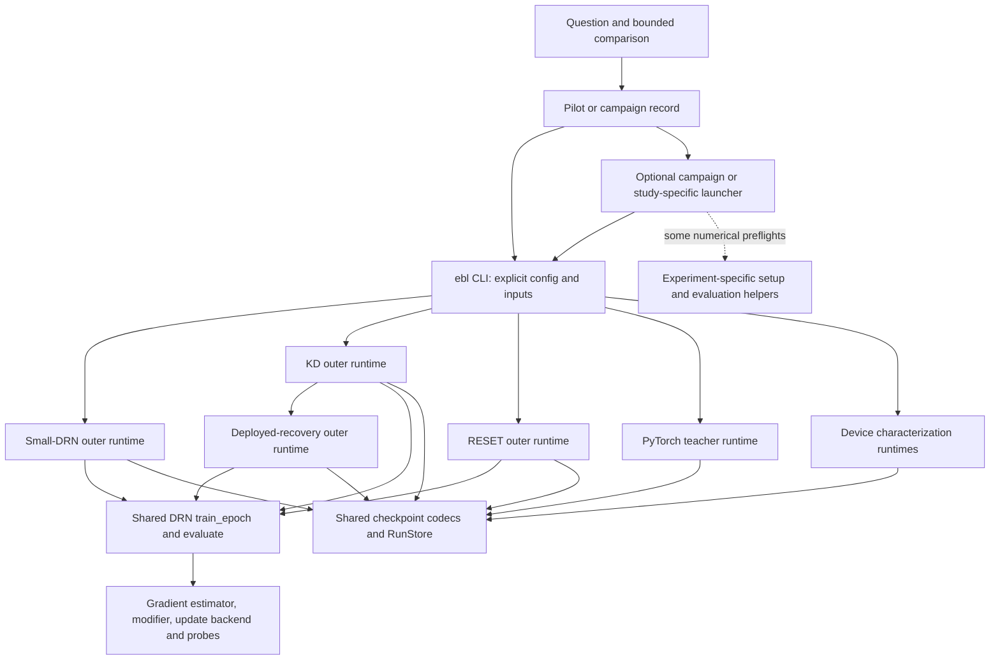

# Training-path audit and reusable DRN lifecycle design

State: audit complete; proposed design ready for discussion, not implemented.
Date: 2026-10-05. Owner: coordinating agent. Authorized scope: local audit and design.
No training, checkpoint replay, remote collection or runtime refactor was performed.

## Decision and principal finding

**Keep the shared numerical engine and extract a reusable run lifecycle above it.**
The four DRN runtime paths already share minibatch execution today, but still assemble
initialization, evaluation, selection, checkpointing and reporting separately. New
update rules can implement `step()` already; the larger integration burden comes from
teaching each outer runner about that backend's preparation, state and evidence.

Use strict configuration plus small Python components. Begin with DRN training and
recovery, and test the design against a new stateful recovery rule. A configuration-only
framework or a universal loop spanning neural training and device characterization is
not justified by this audit. The research lifecycle remains question-led and lean.

The recommended first migration is **small-DRN direct training into a shared run driver,
followed by a measured backend in that same driver**. This exposes whether extension
interfaces actually remove backend-specific runner edits. KD, RESET and physical
recovery follow with their explicit scientific policies preserved. No migration or
new scientific comparison is authorized by this report alone.

## Scope, evidence and limits

The audit covers 52 experiment records in five campaigns plus the original workflow
pilot. These are the records currently organized in campaigns; all 52 campaign records
are historical imports, not evidence of 52 currently running experiments.

The current-code baseline is `3fff35fd5c84673821a8d9634d7b418b02636f19` plus the
working-tree files snapshotted by this audit. It is not substituted for any historical
run's recorded source identity.

The extraction found **432 native manifests**: 236 small-DRN, 148 KD-family, 29 RESET-family,
13 PyTorch teacher and 6 device-characterization invocations. Every manifest is mapped
to an owning record; more specific device-screen roots take precedence over their parent
comparison. Counts include validation, smoke, failed and repeated invocations, not just
production training or independent replicates. Twelve records have no local native
bundle, including a superseded design and a non-training circuit analysis.

All 432 resolved configuration content digests match their native manifests. This is
configuration verification only: checkpoint bytes, full bundle integrity, numerical
results and scientific coverage were **not** revalidated. Recorded status counts are
404 complete, 13 failed and 15 running; those historical markers were not checked against
live processes and do not establish current activity or completed scientific coverage.

There are 15 recorded non-null source commits, of which nine are readable locally;
13 manifests have no native Git identity. Of 432 manifests, 355 record dirty source and
64 record clean source. **Eleven invocations have a clean, locally readable routed
source; two more have a receipt-verified unchanged numerical source in the workflow
pilot.** The remaining 419 have metadata-supported routing but incomplete exact source
reconstruction. A dirty hash identifies content without preserving it; a missing clean
commit is also insufficient to inspect its code.

Two retained `source-final.tgz` archives corroborate the early endpoint small-DRN engine
path, but are not asserted to be the exact launched source for every run in their roots.
The pilot's archived patch and untracked-source archive match their execution-receipt
hashes; neither overrides its small-DRN runtime or numerical engine. Historical source
verification here establishes inspected routing, not numerical replay or validation of
all imported dependencies.

Evidence and reproducibility:

- [Inventory and per-invocation source/config mapping](../../results/training-path-audit-20261005/inventory.json).
- [Read-only extractor](../../results/training-path-audit-20261005/collect.py), run from this repository with `python results/training-path-audit-20261005/collect.py`.
- [Current-source symbol/line index](../../results/training-path-audit-20261005/source-index.json); the inventory links retained snapshots of the inspected current modules.
- [Inventory validation receipt](../../results/training-path-audit-20261005/validation.json).

Small records remain versioned; generated evidence and source snapshots remain ignored.
The audit stayed local and below its 100 MiB storage cap. Its output root is
`results/training-path-audit-20261005/`. No process or monitoring handoff remains active.
The earlier unsolicited lifecycle-policy addition was removed; unrelated changes were
preserved. Historical campaign result judgments were not altered.

## What the current paths actually share



The shared services in the diagram are reused APIs; there is currently no single outer
DRN driver that invokes them for all four runtimes.

| Path | Current implementation and extension seams | Policy that remains distinct |
|---|---|---|
| S1 | [small-network runtime](../../experiments/small_network/runtime.py), `_execute_training`; core `train_epoch`/`evaluate`; EP, BPTT or digital-readout estimator; model adapters and update backends | Training carries equilibrium state (`reset_input=False`); noisy evaluation precedes clean; selection is clean mean cost; layer continuation state is checkpointed; typed epoch observers |
| K1 | [KD runtime](../../experiments/mnist_relu_drn/runtime.py), `_train_epoch`, `_evaluate`, `run_train`; core engine, teacher batch adapter, gain modifier and KD probes | Teacher mapping and deployment; training resets input; clean or fixed-sequence modifier selection; selectable metric; source/gain/assignment compatibility checks |
| Z1 | [RESET runtime](../../experiments/mnist_relu_drn_reset/runtime.py), `train_epoch`, `evaluate`, `run_train`; core engine and supervision probe | Measured RESET initialization; CE/KL/paired objective; bounded LR selection followed by controlled production construction; explicit reset/carry setting; objective-loss selection |
| R1 | [deployed-recovery runtime](../../experiments/mnist_relu_drn/ibm_om_deployed_recovery.py), `run_recovery_train`; K1 gradient pass or core gradient-free refresh | Exact saved deployed array; direct-pulse calibration, budgets and fast-array state; epoch gain calibration; apparent primary and persistent diagnostic evaluation; fixed terminal epoch, no best-validation selection |
| T | [ReLU teacher runtime](../../experiments/mnist_relu/runtime.py) | Ordinary PyTorch minibatch/epoch loops; supporting teacher, not the evaluated perfect-diode student |
| P | [program-and-verify runtime](../../experiments/reram_program_verify/runtime.py) | Device/repeat/start/target/controller trajectories, explicit RNG, streamed evidence and endpoint fitting; not a training epoch loop |
| C | [raw-cell characterization runtime](../../experiments/reram_program_verify/raw_active_cell_runtime.py) | Common-cell level conditioning/programming and held-out checks; not neural training |
| X | Circuit verification and standalone replay/analysis helpers | Diagnostics of equations or saved evidence; no training-loop equivalence implied |

### Historical evolution

- `d640f61` (2026-07-27) introduced composable runtime contracts including
  `training/engine.py`; `f65db65` introduced the small-DRN runtime. At historical
  `8d3d640`, its outer epoch loop already calls that engine. **The engine did not
  originate in October.**
- Historical KD and RESET source at readable August revisions contains hand-written
  minibatch training/evaluation loops. The clean common-window and four/eight-device
  runs provide direct historical KD examples, while many other histories are inferred
  from config/notes because source patches or revisions are missing.
- `3cd5801` (October 4) routed lab wrappers through the shared engine; `177e68b` moved
  numerical code into `training/core` and separated the lab harness. These were broader
  consolidation and package-boundary changes, not the birth of the small-DRN engine.
- `4af6f1e` (October 5) made gradient/update stages optional in components. `263864e`
  routed RESET-family passes through the engine. `6554ef1` routed KD, recovery helper
  passes and decomposition evaluation through it.
- Current per-epoch orchestration remains separate. Calibration also has outer repetition
  and scalar probability-solving loops; those are not automatically duplicate minibatch
  engines.

For the inventory below, S0 means the old shared `training.engine` path, K0 and Z0 mean
the historical family-owned minibatch loops, and R0 means historical recovery helpers
plus K0 for gradient training. S1/K1/Z1/R1 use `training.core.engine`. The arrow maps
historical implementation class to its present counterpart; it does **not** mean an old
configuration is accepted unchanged today or that an inferred dirty source is exact.

## Complete record-to-path inventory

**V** = historical routed source inspected with a clean commit or receipt-bound numerical
source; **I** = family/path supported by native metadata but exact historical source
incomplete; **D** = documentary/config evidence only. Each linked record retains its own
historical scientific result and limitations. Native invocation counts include auxiliary
runs and retries. Detailed command, config, backend parameters, source variant and status
remain in the inventory JSON rather than being collapsed into the path letter.


### endpoint-hwa-recovery

| Record | Historical → current path | Local native invocations / attribution | Distinct behavior |
|---|---|---|---|
| [exp-001 — Early hard-sigmoid adapter smoke](../../campaigns/endpoint-hwa-recovery/series/001-early-controls/experiments/exp-001-adapter-smoke.md) · [evidence](../../campaigns/endpoint-hwa-recovery/series/001-early-controls/results/exp-001-adapter-smoke.md) | S0 → S1 | 11; 11 I | Hard-sigmoid historical control; EP, passive factors, direct updates. |
| [exp-002 — Perfect-diode digits HWA and LoRA](../../campaigns/endpoint-hwa-recovery/series/001-early-controls/experiments/exp-002-digits.md) · [evidence](../../campaigns/endpoint-hwa-recovery/series/001-early-controls/results/exp-002-digits.md) | S0 → S1 | 63; 63 I | Digits: EP base/HWA and passive LoRA; direct updates; separate validation. |
| [exp-003 — Endpoint device screen and CMO correction direction](../../campaigns/endpoint-hwa-recovery/series/001-early-controls/experiments/exp-003-device-screen.md) · [evidence](../../campaigns/endpoint-hwa-recovery/series/001-early-controls/results/exp-003-device-screen.md) | S0 → S1 | 5; 5 I | Endpoint device screen: EP passive LoRA; device deployment differs. |
| [exp-004 — MNIST HWA and physical LoRA rank study](../../campaigns/endpoint-hwa-recovery/series/002-mnist-low-rank/experiments/exp-004-rank-study.md) · [evidence](../../campaigns/endpoint-hwa-recovery/series/002-mnist-low-rank/results/exp-004-rank-study.md) | S0 → S1 | 57; 57 I | MNIST rank sweeps: BPTT, direct updates, base/HWA and passive factors. |
| [exp-005 — Full-model rewriting control](../../campaigns/endpoint-hwa-recovery/series/002-mnist-low-rank/experiments/exp-005-full-finetune.md) · [evidence](../../campaigns/endpoint-hwa-recovery/series/002-mnist-low-rank/results/exp-005-full-finetune.md) | S0 → S1 | 11; 11 I | BPTT direct full-model update control; do not equate with pulse recovery. |
| [exp-006 — PCM/CMO repeated noisy recovery](../../campaigns/endpoint-hwa-recovery/series/003-endpoint-and-floor/experiments/exp-006-pcm-cmo-noisy.md) · [evidence](../../campaigns/endpoint-hwa-recovery/series/003-endpoint-and-floor/results/exp-006-pcm-cmo-noisy.md) | S0 → S1 | 9; 9 I | BPTT endpoint rewriting via program_verify; full and LoRA paths. |
| [exp-007 — CMO literal-floor recovery](../../campaigns/endpoint-hwa-recovery/series/003-endpoint-and-floor/experiments/exp-007-literal-floor.md) · [evidence](../../campaigns/endpoint-hwa-recovery/series/003-endpoint-and-floor/results/exp-007-literal-floor.md) | S0 → S1 | 4; 4 I | Same endpoint backend, literal conductance floor. |
| [exp-008 — Literal versus affine floor mechanisms](../../campaigns/endpoint-hwa-recovery/series/003-endpoint-and-floor/experiments/exp-008-floor-mechanism.md) · [evidence](../../campaigns/endpoint-hwa-recovery/series/003-endpoint-and-floor/results/exp-008-floor-mechanism.md) | S0 → S1 | 2; 2 I | Endpoint probes plus custom analysis/replay; not a new training engine. |
| [exp-009 — Independently initialized CMO/Wan comparison](../../campaigns/endpoint-hwa-recovery/series/003-endpoint-and-floor/experiments/exp-009-wan-cmo-independent.md) · [evidence](../../campaigns/endpoint-hwa-recovery/series/003-endpoint-and-floor/results/exp-009-wan-cmo-independent.md) | S0 → S1 | 11; 11 I | Independent CMO/Wan: small-DRN BPTT, endpoint updates and Gaussian HWA. |
| [exp-010 — Teacher-initialized CMO/Wan comparison](../../campaigns/endpoint-hwa-recovery/series/003-endpoint-and-floor/experiments/exp-010-wan-cmo-teacher.md) · [evidence](../../campaigns/endpoint-hwa-recovery/series/003-endpoint-and-floor/results/exp-010-wan-cmo-teacher.md) | K0 → K1, T | 17; 17 I | Teacher-initialized CMO/Wan: switches to KD runtime; teacher validation dependency. |

### initialization-and-representation

| Record | Historical → current path | Local native invocations / attribution | Distinct behavior |
|---|---|---|---|
| [exp-001 — Learning from measured RESET](../../campaigns/initialization-and-representation/series/001-reset-and-objective/experiments/exp-001-reset.md) · [evidence](../../campaigns/initialization-and-representation/series/001-reset-and-objective/results/exp-001-reset.md) | T, Z0 → Z1 | 6; 6 I | Measured RESET; CE/KL objectives, LR selection; PyTorch teacher stages. |
| [exp-002 — Bias, loss and historical amplifier indexing](../../campaigns/initialization-and-representation/series/001-reset-and-objective/experiments/exp-002-bias-and-indexing.md) · [evidence](../../campaigns/initialization-and-representation/series/001-reset-and-objective/results/exp-002-bias-and-indexing.md) | T, Z0 → Z1 | 11; 11 I | RESET bias/legacy-index variants; CE/KL/paired loss; teacher stages. |
| [exp-003 — RESET loss × bias × indexing factorial](../../campaigns/initialization-and-representation/series/001-reset-and-objective/experiments/exp-003-reset-factorial.md) · [evidence](../../campaigns/initialization-and-representation/series/001-reset-and-objective/results/exp-003-reset-factorial.md) | Z0 → Z1 | 18; 18 I | RESET loss/bias/index factorial; local and collected shards/smokes. |
| [exp-004 — Ten-epoch differential RESET](../../campaigns/initialization-and-representation/series/001-reset-and-objective/experiments/exp-004-differential-reset.md) · [evidence](../../campaigns/initialization-and-representation/series/001-reset-and-objective/results/exp-004-differential-reset.md) | Z0 → Z1 | 0; D; no native bundle | Differential RESET paired loss; config/campaign available, raw root absent. |
| [exp-005 — Teacher-initialized measured DRN distillation](../../campaigns/initialization-and-representation/series/002-teacher-and-representation/experiments/exp-005-teacher-distillation.md) · [evidence](../../campaigns/initialization-and-representation/series/002-teacher-and-representation/results/exp-005-teacher-distillation.md) | K0 → K1, T | 21; 21 I | Teacher mapping + KD; ideal/measured backends; PyTorch teacher stages. |
| [exp-006 — Ten-epoch teacher-initialized differential control](../../campaigns/initialization-and-representation/series/002-teacher-and-representation/experiments/exp-006-differential-ten-epoch.md) · [evidence](../../campaigns/initialization-and-representation/series/002-teacher-and-representation/results/exp-006-differential-ten-epoch.md) | K0 → K1 | 0; D; no native bundle | Differential teacher-initialized KD; raw root absent. |
| [exp-007 — Ten-epoch teacher-initialized single-conductance control](../../campaigns/initialization-and-representation/series/002-teacher-and-representation/experiments/exp-007-single-ten-epoch.md) · [evidence](../../campaigns/initialization-and-representation/series/002-teacher-and-representation/results/exp-007-single-ten-epoch.md) | K0 → K1 | 0; D; no native bundle | Single-device teacher-initialized KD; raw root absent. |
| [exp-008 — Pairwise common window versus bounded FP32](../../campaigns/initialization-and-representation/series/002-teacher-and-representation/experiments/exp-008-common-window-fp32.md) · [evidence](../../campaigns/initialization-and-representation/series/002-teacher-and-representation/results/exp-008-common-window-fp32.md) | K0 → K1 | 4; 4 V | KD measured pairwise common-window versus ideal FP32. |
| [exp-009 — Four versus eight measured devices](../../campaigns/initialization-and-representation/series/002-teacher-and-representation/experiments/exp-009-four-versus-eight.md) · [evidence](../../campaigns/initialization-and-representation/series/002-teacher-and-representation/results/exp-009-four-versus-eight.md) | K0 → K1 | 4; 4 V | KD four/eight-device representations; matched mapping and solver. |
| [exp-010 — Independently trained bounded DRN reference](../../campaigns/initialization-and-representation/series/003-bounded-learning/experiments/exp-010-bounded-teacher.md) · [evidence](../../campaigns/initialization-and-representation/series/003-bounded-learning/results/exp-010-bounded-teacher.md) | S0 → S1 | 2; 2 V | Bounded reference is itself a DRN: small-DRN BPTT/direct, not PyTorch teacher. |
| [exp-011 — Direct ReLU-to-bounded FP32 mapping](../../campaigns/initialization-and-representation/series/003-bounded-learning/experiments/exp-011-relu-bounded-map.md) · [evidence](../../campaigns/initialization-and-representation/series/003-bounded-learning/results/exp-011-relu-bounded-map.md) | K0 → K1 | 2; 2 I | KD ReLU-to-bounded mapping and zero-update control. |
| [exp-012 — Full-range uniform bounded initialization](../../campaigns/initialization-and-representation/series/003-bounded-learning/experiments/exp-012-uniform-initialization.md) · [evidence](../../campaigns/initialization-and-representation/series/003-bounded-learning/results/exp-012-uniform-initialization.md) | S0 → S1 | 2; 2 I | Small-DRN uniform initialization, BPTT/direct. |
| [exp-013 — Uniform-initialization learning-rate screen](../../campaigns/initialization-and-representation/series/003-bounded-learning/experiments/exp-013-uniform-lr-screen.md) · [evidence](../../campaigns/initialization-and-representation/series/003-bounded-learning/results/exp-013-uniform-lr-screen.md) | S0 → S1 | 3; 3 I | Small-DRN LR sweep, BPTT/direct; three local train invocations. |
| [exp-014 — SGD and Adam within heterogeneous OM cell bounds](../../campaigns/initialization-and-representation/series/003-bounded-learning/experiments/exp-014-cell-bounds-optimizers.md) · [evidence](../../campaigns/initialization-and-representation/series/003-bounded-learning/results/exp-014-cell-bounds-optimizers.md) | S0 → S1 | 12; 12 I | Small-DRN ibm_om_fp32_bounds wrapping SGD/Adam. |
| [exp-015 — Expanded SGD learning-rate control](../../campaigns/initialization-and-representation/series/003-bounded-learning/experiments/exp-015-expanded-sgd.md) · [evidence](../../campaigns/initialization-and-representation/series/003-bounded-learning/results/exp-015-expanded-sgd.md) | S0 → S1 | 13; 13 I | Same bounded optimizer path, expanded SGD rates. |
| [exp-016 — Amplifier equation and residual verification](../../campaigns/initialization-and-representation/series/004-circuit-verification/experiments/exp-016-amplifier-equations.md) · [evidence](../../campaigns/initialization-and-representation/series/004-circuit-verification/results/exp-016-amplifier-equations.md) | X | 0; D; no native bundle | Saved amplifier-equation/residual analysis; no native training invocation. |

### measured-cohort-adaptation

| Record | Historical → current path | Local native invocations / attribution | Distinct behavior |
|---|---|---|---|
| [exp-001 — Raw and isotonic cohort-A feasibility](../../campaigns/measured-cohort-adaptation/series/001-transfer-and-write-policies/experiments/exp-001-cohort-a.md) · [evidence](../../campaigns/measured-cohort-adaptation/series/001-transfer-and-write-policies/results/exp-001-cohort-a.md) | S0 → S1 | 4; 4 I | Small-DRN BPTT, measured_cohort_a raw/isotonic projection. |
| [exp-002 — Cohort-B transfer and learning-rate controls](../../campaigns/measured-cohort-adaptation/series/001-transfer-and-write-policies/experiments/exp-002-cohort-b-transfer.md) · [evidence](../../campaigns/measured-cohort-adaptation/series/001-transfer-and-write-policies/results/exp-002-cohort-b-transfer.md) | S0 → S1 | 3; 3 I | Small-DRN measured_cohort_b, transfer and auto-LR reproduction. |
| [exp-003 — Fixed-rate programming deadbands](../../campaigns/measured-cohort-adaptation/series/001-transfer-and-write-policies/experiments/exp-003-deadband.md) · [evidence](../../campaigns/measured-cohort-adaptation/series/001-transfer-and-write-policies/results/exp-003-deadband.md) | S0 → S1 | 9; 9 I | Same measured backend with deterministic write deadbands. |
| [exp-004 — Matched probabilistic write policies](../../campaigns/measured-cohort-adaptation/series/001-transfer-and-write-policies/experiments/exp-004-probabilistic-writing.md) · [evidence](../../campaigns/measured-cohort-adaptation/series/001-transfer-and-write-policies/results/exp-004-probabilistic-writing.md) | S0 → S1 | 8; 8 I | Same measured backend with stochastic write admission and RNG state. |
| [exp-005 — Corrected RESET passive LoRA recovery](../../campaigns/measured-cohort-adaptation/series/002-low-rank-recovery/experiments/exp-005-cohort-b-lora.md) · [evidence](../../campaigns/measured-cohort-adaptation/series/002-low-rank-recovery/results/exp-005-cohort-b-lora.md) | S0 → S1 | 5; 5 I | Small-DRN passive factors; base frozen; RESET factor initialization. |
| [exp-006 — Differential A-to-B adaptation](../../campaigns/measured-cohort-adaptation/series/003-representation-transfer/experiments/exp-006-differential-transfer.md) · [evidence](../../campaigns/measured-cohort-adaptation/series/003-representation-transfer/results/exp-006-differential-transfer.md) | K0 → K1 | 0; D; no native bundle | KD differential A/B stages, literal/common-window transfer; raw root absent. |
| [exp-007 — Four-device A-to-B adaptation](../../campaigns/measured-cohort-adaptation/series/003-representation-transfer/experiments/exp-007-four-device-transfer.md) · [evidence](../../campaigns/measured-cohort-adaptation/series/003-representation-transfer/results/exp-007-four-device-transfer.md) | K0 → K1 | 4; 3 I, 1 V | KD four-device A/B transfer and no-update control. |
| [exp-008 — Five held-out four-device assignments](../../campaigns/measured-cohort-adaptation/series/003-representation-transfer/experiments/exp-008-five-assignment-transfer.md) · [evidence](../../campaigns/measured-cohort-adaptation/series/003-representation-transfer/results/exp-008-five-assignment-transfer.md) | K0 → K1 | 0; D; no native bundle | KD assignment sweep; plan/configs available, raw root absent. |
| [exp-009 — Four-device sign-only SGD](../../campaigns/measured-cohort-adaptation/series/004-update-locality/experiments/exp-009-sign-sgd.md) · [evidence](../../campaigns/measured-cohort-adaptation/series/004-update-locality/results/exp-009-sign-sgd.md) | K0 → K1 | 0; D; no native bundle | KD measured backend plus sign-SGD; plan/configs, raw root absent. |
| [exp-010 — Unthresholded one-pulse-down control](../../campaigns/measured-cohort-adaptation/series/004-update-locality/experiments/exp-010-one-pulse-down.md) · [evidence](../../campaigns/measured-cohort-adaptation/series/004-update-locality/results/exp-010-one-pulse-down.md) | K0 → K1 | 0; D; no native bundle | KD measured_cohort_a_one_pulse_down; plan/configs, raw root absent. |
| [exp-011 — Four-device one-pulse gradient thresholds](../../campaigns/measured-cohort-adaptation/series/004-update-locality/experiments/exp-011-four-device-thresholds.md) · [evidence](../../campaigns/measured-cohort-adaptation/series/004-update-locality/results/exp-011-four-device-thresholds.md) | K0 → K1 | 0; D; no native bundle | Same one-pulse backend with calibrated gradient thresholds; raw root absent. |
| [exp-012 — Eight-device gradient-threshold follow-up](../../campaigns/measured-cohort-adaptation/series/004-update-locality/experiments/exp-012-eight-device-thresholds.md) · [evidence](../../campaigns/measured-cohort-adaptation/series/004-update-locality/results/exp-012-eight-device-thresholds.md) | K0 → K1 | 11; 11 I | KD eight-device thresholds; local retries and collected remote invocations. |

### ibm-om-deployment-recovery

| Record | Historical → current path | Local native invocations / attribution | Distinct behavior |
|---|---|---|---|
| [exp-001 — Initial population HWA/programming pilot](../../campaigns/ibm-om-deployment-recovery/series/001-common-window/experiments/exp-001-population-hwa.md) · [evidence](../../campaigns/ibm-om-deployment-recovery/series/001-common-window/results/exp-001-population-hwa.md) | K0 → K1 | 4; 4 I | KD/HWA train arms; programming/preflight also lives in launcher helpers. |
| [exp-002 — Corrected fixed-array common-window HWA](../../campaigns/ibm-om-deployment-recovery/series/001-common-window/experiments/exp-002-fixed-array.md) · [evidence](../../campaigns/ibm-om-deployment-recovery/series/001-common-window/results/exp-002-fixed-array.md) | K0 → K1 | 4; 4 I | Fixed-array mapping and noisy selection; v1/v2 attempts retained. |
| [exp-003 — Interrupted eight-device differential-pair pilot](../../campaigns/ibm-om-deployment-recovery/series/001-common-window/experiments/exp-003-eight-device.md) · [evidence](../../campaigns/ibm-om-deployment-recovery/series/001-common-window/results/exp-003-eight-device.md) | K0 → K1 | 2; 2 I | Eight-device variant; recorded partial/interrupted work, not full coverage. |
| [exp-004 — Shared RESET-relative nine-level QAT](../../campaigns/ibm-om-deployment-recovery/series/002-reset-relative/experiments/exp-004-shared-quantization.md) · [evidence](../../campaigns/ibm-om-deployment-recovery/series/002-reset-relative/results/exp-004-shared-quantization.md) | K0 → K1 | 26; 26 I | KD QAT/continuous controls and explicit held-out deployment validation. |
| [exp-005 — Matched refresh, direct-pulse and Tiki-Taka recovery](../../campaigns/ibm-om-deployment-recovery/series/002-reset-relative/experiments/exp-005-pulse-recovery.md) · [evidence](../../campaigns/ibm-om-deployment-recovery/series/002-reset-relative/results/exp-005-pulse-recovery.md) | K0 → K1, R0 → R1 | 14; 14 I | Exact deployment input; refresh/direct/ideal-fast/physical-fast TT; terminal selection. |
| [exp-006 — Direct-pulse gradient-threshold follow-up](../../campaigns/ibm-om-deployment-recovery/series/002-reset-relative/experiments/exp-006-gradient-thresholds.md) · [evidence](../../campaigns/ibm-om-deployment-recovery/series/002-reset-relative/results/exp-006-gradient-thresholds.md) | R0 → R1 | 9; 9 I | R with direct gradient gate calibration and fixed pulse caps. |
| [exp-007 — Canonical-axis TTv2 repair](../../campaigns/ibm-om-deployment-recovery/series/002-reset-relative/experiments/exp-007-ttv2-repair.md) · [evidence](../../campaigns/ibm-om-deployment-recovery/series/002-reset-relative/results/exp-007-ttv2-repair.md) | R0 → R1 | 1; 1 I | R with TTv2 fast-state and transfer-buffer semantics. |
| [exp-008 — Raw-active canary and learning-rate screen](../../campaigns/ibm-om-deployment-recovery/series/003-raw-active/experiments/exp-008-readiness-and-rates.md) · [evidence](../../campaigns/ibm-om-deployment-recovery/series/003-raw-active/results/exp-008-readiness-and-rates.md) | K0 → K1 | 8; 8 I | KD raw-active canaries and LR screening; distinct initialization helper. |
| [exp-009 — Held-out raw-active seven-level QAT](../../campaigns/ibm-om-deployment-recovery/series/003-raw-active/experiments/exp-009-seven-level-qat.md) · [evidence](../../campaigns/ibm-om-deployment-recovery/series/003-raw-active/results/exp-009-seven-level-qat.md) | K0 → K1 | 24; 24 I | KD seven-level QAT, continuous controls and deployment repetitions. |

### ibm-om-programming

| Record | Historical → current path | Local native invocations / attribution | Distinct behavior |
|---|---|---|---|
| [exp-001 — Original exhaustive controller design](../../campaigns/ibm-om-programming/series/001-controller-and-endpoint/experiments/exp-001-exhaustive-design.md) · [evidence](../../campaigns/ibm-om-programming/series/001-controller-and-endpoint/results/exp-001-exhaustive-design.md) | P | 0; D; planned/superseded | Superseded exhaustive design; no execution inferred. |
| [exp-002 — Short-production programming and endpoint model](../../campaigns/ibm-om-programming/series/001-controller-and-endpoint/experiments/exp-002-short-production.md) · [evidence](../../campaigns/ibm-om-programming/series/001-controller-and-endpoint/results/exp-002-short-production.md) | P | 0; D; no native bundle | Pulse trajectories and endpoint fitting; historical result root absent. |
| [exp-003 — 128-pulse successor specification](../../campaigns/ibm-om-programming/series/001-controller-and-endpoint/experiments/exp-003-cap128-successor.md) · [evidence](../../campaigns/ibm-om-programming/series/001-controller-and-endpoint/results/exp-003-cap128-successor.md) | P | 0; D; no native bundle | Cap-128 successor; historical result root absent. |
| [exp-004 — Focused cap-128 HWA endpoint prerequisite](../../campaigns/ibm-om-programming/series/001-controller-and-endpoint/experiments/exp-004-hwa-device-model.md) · [evidence](../../campaigns/ibm-om-programming/series/001-controller-and-endpoint/results/exp-004-hwa-device-model.md) | P | 2; 2 I | Target-conditioned HWA prerequisite characterization; no epochs/gradients. |
| [exp-005 — Array-wide nine-level physical-cell programming](../../campaigns/ibm-om-programming/series/002-common-cell-levels/experiments/exp-005-nine-cell-levels.md) · [evidence](../../campaigns/ibm-om-programming/series/002-common-cell-levels/results/exp-005-nine-cell-levels.md) | C | 4; 4 I | Common raw cell levels; conditioning/programming/held-out checks, no training. |

### pilots

| Record | Historical → current path | Local native invocations / attribution | Distinct behavior |
|---|---|---|---|
| [workflow-pilot — Bounded workflow control](../../campaigns/pilots/20260925-lora-bounded-learning.md) | S0 → S1 | 2; 2 V | EP direct update versus zero-rate synthetic control; verifies workflow, not device science. |


## Where duplication and coupling remain

### 1. The outer lifecycle is copied; the minibatch engine mostly is not

`S._execute_training`, `K.run_train`, `Z.run_train` and `R.run_recovery_train` each own an
epoch traversal, epoch/global-step bookkeeping, evaluation, checkpoint serialization,
metric publication and final artifacts. Their principal bodies span approximately
560, 906, 478 and 415 lines respectively at the inspected source; these are function
sizes, **not** a count of identical or removable lines. Much of the code is valid
scientific preparation. Extracting the shared sequence is useful only if that preparation
can remain explicit and local.

Already consolidated: batch execution order, modifier context, gradient assignment,
finite-gradient guards, batch/sample limits, teacher targets and several probes. Keep
these interfaces instead of building another engine or moving lab dependencies into core.

### 2. Update backends leak into lifecycle bookkeeping

In S, `build_train_runtime` selects/wraps optimizers, while `_execute_training` separately
recognizes measured-A, measured-B, LoRA, program-verify and IBM-bounded optimizers for
initialization evidence, diagnostics or extra artifacts. `configured_resume_capability`
also interprets backend configuration before the constructed runtime reports capability.
K separately identifies measured/programming optimizers and their reports. R dispatch is
an explicit backend condition in K that selects a separate outer runtime.

The backend's math need not change to fix this. A factory can return an update binding
that supplies the step object, checkpoint state, declared capabilities and evidence
providers together. The runner then consumes those interfaces instead of recognizing
specific optimizer classes. A static composition registry remains appropriate; unrestricted
Python import strings in JSON are unnecessary.

Historical integration evidence reinforces this finding:

| Addition | Source evidence | Integration surface beyond the update math |
|---|---|---|
| Device and low-rank small-DRN support | `3911859` | Registry, config, components and runtime all changed; runtime gained initialization/deployment/report handling |
| Four-device sign and one-pulse studies | `f891da7` | Config/registry/components plus KD runtime and measured backend; gradient-threshold setup is a preparation concern |
| IBM physical recovery | `31561f9` | Existing KD dispatch plus dedicated recovery runtime, config, checkpoint metadata, launchers and backend |
| Optional numerical stages | `4af6f1e`, `263864e`, `6554ef1` | Gradient-free refresh and gradient-only calibration now reuse core; demonstrates a useful abstraction already in place |

These commits aggregate related work; their size is not a benchmark of the cost of one
isolated backend addition. The concrete maintenance issue is the distributed responsibility.

### 3. Evaluation has effects on future training

S deliberately carries equilibrium state and preserves it for resume. Its ordinary
validation can leave the layer state used by the next epoch; some initialization probes
snapshot and restore it explicitly. K's selection repeats snapshot and restore modifier
state, while gain and teacher-target handling are composed separately. R gain calibration
changes the subsequent training gain, whereas persistent-state diagnostic evaluation must
restore the apparent view.

Therefore a generic `evaluate()` callback that promises to be harmless is insufficient.
The lifecycle must know the named pass, its order, which state it may change and whether
those changes are retained or restored. Preserve existing behavior during migration;
changing diagnostic isolation or reset policy is a scientific intervention, not cleanup.

S selects clean cost, K has selectable clean/modifier policies, Z selects its objective,
and R retains the fixed terminal state. These are intentional differences. The meaning
of “clean” also depends on the parameter representation: it is not automatically a hidden
persistent-state forward. Audit the actual view before making an apparent-state compliance
claim. A future physical run must explicitly bind its primary view to held apparent state.

### 4. Selection and resumption need different snapshots

The shared checkpoint codec already distinguishes current continuation weights from
selected named weights and captures optimizer, modifier, scheduler, runtime and RNG state.
That is a foundation to reuse. Each runner still assembles its own metadata/progress
payload, and exactness depends on including every state owner.

Named weights alone do not recreate a physical deployed array or fast accumulator.
Selection must identify the state artifact being selected, while epoch-boundary resume
must retain the complete continuation. R currently avoids a best-state ambiguity by
retaining the terminal epoch and exporting its recovery bundle. A future physical
best-validation policy would need a full selected physical-state export, not merely a
weights filename. Do not introduce that scientific policy incidentally in a refactor.

### 5. Campaign stage composition and numerical setup are partially mixed

The generic campaign runner invokes each worktree's CLI as a subprocess and resolves
explicit artifact dependencies. That boundary is useful. Some specialized common-window
and differential-pair launchers additionally construct DRNs, replay checkpoints and
perform numerical preflights by importing private runtime helpers. Deployment decomposition
has a separate diagnostic entry point and uses shared evaluation today.

These are extension pressure points, not evidence that all launchers are obsolete.
First keep their numerical preparation as explicit experiment components; later expose
reusable preparation/deployment stages through the established CLI when multiple protocols
need them. Do not turn the new epoch driver into a scheduler or import another worktree's
numerical code into a controller.

Legacy calls to `refresh_current_simulations_for_run` still appear in launchers, but the
current implementation is a **compatibility no-op**. Their presence does not show that
launchers currently rewrite the frozen global documents.

### 6. Provenance limits retrospective maintenance

Most exact historical sources cannot be reconstructed from the recorded dirty identity
alone. This is a limitation on attributing implementation differences, not proof that
results are wrong. Future runs should retain the source patch/untracked code or a source
snapshot tied to their native source identity, as the existing workflow policy already
requires. Centralizing that packaging at launch avoids every new experiment inventing
its own source receipt. It should preserve dirty research work, not impose a clean-tree
requirement on all pilots.

## Proposed reusable lifecycle

This section is an internal API proposal for review, not a claim that these types exist.
Keep `python -m ebl`, current experiment IDs, strict family configs and native bundles.
Locate the future driver in the experiment/runtime layer: `training/core` must remain
independent of configuration, persistence and campaign orchestration.

### Ownership and minimal interfaces

| Proposed interface | Responsibility and minimum contract |
|---|---|
| `prepare_run(request) -> PreparedDrnRun` | Existing family composition validates scientific inputs and constructs or restores the model, data, update binding and policies. Owns teacher/device mapping, RESET, LR search and deployment identity checks. Returns initialization evidence. Fresh-only commissioning/search must not run on resume. |
| `PreparedDrnRun` | Holds existing training/evaluation components, fresh batch-iterator factories, explicit reset/clamp policy, ordered evaluation actions, selection policy, checkpoint bindings and a family report adapter. It has no epoch loop. |
| `UpdateBinding` | Holds the existing `step()` object, `requires_gradients`, clamp policy, resume capability, diagnostics and artifact exporters. The same stateful update object is bound to the engine and checkpoint codec. It retains `state_dict()`/`load_state_dict()`; physical refresh remains the backend's responsibility. |
| `EvaluationPlan` | Defines ordered named calibration/evaluation actions at initialization, epoch boundaries and finalization. Each action declares its state effects and primary/diagnostic role, returns metrics and uses existing core evaluation/probes where applicable. It cannot secretly run a second training epoch. |
| `SelectionPolicy` | Consumes named metric results and returns a selection decision. Initial implementations: best declared metric and fixed terminal state. Metric direction, ties, eligible evaluation and initial-state eligibility are explicit and preserve each existing path. Its state is checkpointed. |
| `CheckpointBindings` | Connects the existing catalog, optimizer, modifier, scheduler, runtime state, progress and named generators to the existing checkpoint codec. Owns complete continuation independently of selected outputs. Composite runtime state can hold named auxiliary components; no new checkpoint format is required for the first extraction. |
| `ReportAdapter` | Projects common progress/metrics and component diagnostics into existing family result schemas and artifact kinds. Exporters provide scientific payloads; shared persistence handles atomic writes, hashes, indexes and terminal status. |

This is a handful of typed responsibilities around existing mechanisms, not a new generic
workflow language. Use explicit factories and ordered actions, not arbitrary callbacks
at every source line. A novel action must name its state effects and have a focused
contract test. Normal configuration variants and normal update backends should not require
new lifecycle actions.

### Driver ordering

```text
validate config, supported combination and explicit inputs
open the native run bundle and record source/input identity
prepare fresh state OR restore the declared continuation
run declared fresh-only setup/calibration and initial evaluation/selection
for each remaining epoch:
    invoke core train_epoch with the prepared components and batch factory
    advance common epoch/global-step progress
    execute ordered boundary calibration/evaluation actions
    apply declared selection policy and retain the required selected state
    save the full epoch-boundary continuation
    publish metrics and progress according to the existing reporting policy
validate declared terminal condition
export final/selected scientific artifacts and finalize the native bundle
on error: retain failed evidence and last valid continuation, then propagate failure
```

Scientific preparation may rebuild a production model after a bounded LR search; the
family's preparation protocol owns that operation and proves matching. Initialization
observations must remain distinguishable from trial/search observations. Resume skips
fresh-only setup but may run an explicitly declared, state-safe resume validation.

A zero-learning-rate control still executes the declared passes. Gradient-free refresh
still performs its declared forward/measurement and update stages. A gradient-only probe
uses `optimizer=None`. The driver must not optimize away these distinctions.

The first migration preserves current family ordering through explicit policies, including
logging cadence and observers. It must handle an already-completed resume horizon without
inventing an epoch, and create the self-contained artifacts required by the existing run
contract. Stop/budget checks happen at declared safe boundaries; no unsupported mid-epoch
resume is implied. Fixed-horizon recovery must not report successful completion if its
required terminal step was not reached.

### State and scientific safeguards

- **Physical state:** the update backend owns persistent mutation and held apparent refresh
  of touched cells. All device-facing training and primary evaluation consume that held
  apparent view. Persistent evaluation is an isolated, named diagnostic and cannot drive
  gradients or selection. Off-chip HWA updates a digital master through a sampled hardware
  view; its master is not described as persistent physical device state.
- **State ownership:** each mutable object is checkpointed once. The optimizer owns its
  accumulators, plant state and private RNG; the modifier owns its sampled-view state;
  runtime bindings own equilibrium carry, gain and auxiliary protocol state. The driver
  owns counters, selected-epoch progress and generator bindings. Adapters must not save
  the same mutable object independently under conflicting owners.
- **Evaluation effects:** actions explicitly declare retained or restored effects. A
  repeated modifier-selection pass restores the modifier stream when its protocol requires
  that. A diagnostic restores the physical view. Gain calibration can retain its declared
  gain update. Existing carry behavior is preserved explicitly; new isolation behavior is
  a separately reviewed protocol choice.
- **Failure:** cleanup/restoration must also run when a probe, calibration or exporter
  raises. Atomic checkpoint writes preserve the previous valid checkpoint. Failed attempts
  remain visible. A restore failure must not leave a partially mutated model usable.
- **Selection:** diagnostic metrics are ineligible as the primary selector. For a physical
  best-state protocol, the selected artifact must contain all required physical state;
  the initial implementation keeps existing terminal-only recovery semantics.
- **Capabilities:** resolve supported combinations from the existing explicit registry.
  Reject unsupported state/gradient/view combinations before training. Capabilities must
  distinguish exact, stateful-nondeterministic and unsupported resume; never infer exact
  resume simply because an object implements serialization methods.

### Extension guide

| New work | What the author changes | What is reused |
|---|---|---|
| New rate/seed/budget or existing supported combination | Strict config and bounded experiment/pilot specification | Components, driver, selection/checkpoints, artifacts and monitoring contract |
| New recovery/update rule | Focused backend implementation and state codec, strict backend config/factory registration, binding of initialization/diagnostics/export needs, focused numerical and continuation tests | Existing DRN architecture/data setup when applicable, core step engine, epoch driver, evaluation, checkpoint scheduling, progress and failure handling |
| New diagnostic | Probe or named evaluation action, output declaration and state-restoration test | Batch traversal, view handling, report/persistence machinery |
| New scientific protocol | Preparation and ordered evaluation policies; new capability only if an existing interface cannot express the required science | Common run bookkeeping and independently reusable components |
| New sequence of independent runs | Existing subprocess campaign stages and explicit artifact dependencies | Public CLI and per-run lifecycle; no copied numerical launcher |

A new model or cost remains a composition concern, provided it satisfies the existing
network/cost/minimizer interfaces. A fundamentally different numerical algorithm can
require an explicit new engine capability; the design does not promise that arbitrary
future science fits a frozen list of hooks. Such an extension should still reuse run
bookkeeping rather than copying an entire runtime.

### Worked design checks

| Scenario | How it fits | Required proof before migration |
|---|---|---|
| New stateful recovery backend | Existing deployment preparation supplies the matched array; backend implements update/state/report; factory returns `UpdateBinding`; configuration selects it | No new outer epoch loop, backend-type branch in the driver, or duplicated generic checkpoint/status code; full continuation equality for a small controlled trajectory |
| Direct pulses versus rail refresh | Set differentiator versus `None`; use the same core engine; clamp policy is explicit | Exactly one update per intended minibatch; refresh performs no gradient computation; apparent-view semantics hold |
| Gradient-threshold calibration | Fresh-only named preparation pass with gradients and no update; preserve/restore the declared RNG, loader and model state | Following training order and physical state equal the declared uncalibrated starting point except for the retained threshold/scale |
| Best-validation versus terminal recovery | Different `SelectionPolicy`; same continuation writer | Worsening validation cannot silently replace terminal-only recovery with a favorable earlier epoch; selected and continuation state remain distinct |
| Noisy HWA selection | Ordered repeated modifier evaluations with explicit state restoration and aggregate metric | Same noisy sequence/order as the baseline; validation does not accidentally advance the training modifier's RNG |
| Carry-state resume | Bind equilibrium state, loader and update/modifier state to existing codec | Continuous and split execution agree where resume is declared exact, including the boundary after evaluation |
| Budget exhaustion or failure | Backend enforces physical cap; driver validates completion and persists truthful terminal/error records | No additional writes after the declared cap; interrupted evidence is not labelled a completed fixed-horizon comparison |

These are design walkthroughs supported by inspected interfaces, not executed experiments
or a newly implemented prototype. The primary acceptance test for the future design is
extension locality: a second backend must fit without editing the shared driver.

## Prioritized migration recommendations

| Priority | Change and affected paths | Benefit | Preservation risk and gate |
|---|---|---|---|
| 1 | Extract the outer epoch driver from S, initially for direct updates; retain a compatibility report/checkpoint adapter | Establishes one owner for counters, boundary order, status and persistence | Medium: carry state, initial selection, logging and zero-remaining-epoch resume. Gate on existing small-DRN parity/continuation tests and new full-driver event traces |
| 2 | Migrate measured/program-verify S behavior through update/preparation/evidence bindings | Demonstrates that a new backend no longer expands the outer runner | Medium/high: deployment once, frozen bases, private RNG and special evidence. Gate on no-driver-edit second-backend exercise and backend state tests |
| 3 | Adapt K and Z to the same driver while retaining preparation and evaluation policies | Removes repeated bookkeeping across DRN families and shares progress reporting | High: teacher/gain/selection repeats and RESET LR restart. Gate on cross-family initialization-to-final traces, goldens and exact-resume checks |
| 4 | Adapt R with terminal selection, declared calibration and complete physical state | New on-chip rules reuse the lifecycle without a dedicated outer runtime | High: slow/fast plants, pulse caps and diagnostic restoration. Gate on physical-backend goldens, interrupted/continuous parity and terminal-selection tests |
| 5 | Consolidate source packaging and reusable launcher preparation only where duplication is demonstrated | Improves historical reconstructability and reduces bespoke launch scripts | Keep explicit targets/budgets and current public CLI/native evidence; no global registry or new scheduler |

A safe first change should move orchestration while leaving numerical functions, artifact
names and result schemas intact. Existing adapters can preserve old checkpoint progress
layouts. Add schema versions only when a separately justified representation change is
unavoidable. Existing configs/checkpoints need explicit compatibility tests; historical
records with unrecoverable source remain historical, not newly validated by a migration.

## Regression evidence and acceptance

Existing tests were inspected, not executed during this audit. Their presence is evidence
of intended coverage, not a fresh passing result.

| Existing coverage | What it protects | Gap for the proposed lifecycle |
|---|---|---|
| [Engine ordering](../../tests/test_runtime_engine_order_contract.py) and [optional stages](../../tests/test_core_engine_stages_contract.py) | Modifier scope, reset policy, gradient assignment, restore on exception, gradient-only and update-only stages | Cross-epoch ordering and ownership across all family adapters |
| [Training-loop goldens](../../tests/test_training_loop_golden.py), [case registry](../../tests/training_loop_golden_cases.py) | 34 captured KD/RESET/recovery helper cases, including modifiers, limits, calibration helpers and finite-gradient failure | Full initialization, epoch-boundary selection, persistence and finalization parity; current goldens can skip on PyTorch-version mismatch |
| [Small-DRN runtime](../../tests/test_small_network_runtime.py) | Tiny CLI pipeline, exact continuation, carried/rank-layer state, observer failure, frozen bases and modifier provenance | Common driver exercised through a second independent family and a new backend binding |
| [Checkpoint contract](../../tests/test_checkpoint_contract.py) | Atomic writes, complete restore rollback, RNG/generator/runtime state, latest versus selected weights and old schema loading | Coverage proving that each family supplies all required state bindings |
| [RESET protocol](../../tests/test_mnist_relu_drn_reset.py) and [LR selection](../../tests/test_small_network_learning_rate_selection.py) | Objective/config contracts and parameter/layer/optimizer/RNG/loader restoration | Shared driver preserves controlled production restart and does not rerun selection on resume |
| [Physical recovery](../../tests/test_ibm_reram_recovery.py), [recovery config](../../tests/test_ibm_om_deployed_recovery_config.py), [IBM goldens](../../tests/test_ibm_om_golden.py) | Pulse direction/caps, thresholds, TT buffers/cursors, source identity and numerical backend state | Full runner resumes with gain/calibration/history and restores apparent view on every exceptional diagnostic path |
| [Campaign runner](../../tests/test_campaign_runner.py) and [run inspection](../../tests/test_run_inspection.py) | Subprocess/artifact handoffs and native bundle inspection | Shared lifecycle evidence and source packaging across new component combinations |

Before each future migration, capture a compact reference trace from the unchanged relevant
runner, then compare the adapted path on the same inputs. Check model/device state, RNG
continuation, step counts, ordered passes, metrics, selection and artifact semantics.
Separate helper goldens from end-to-end guarantees; do not re-capture numerical goldens
merely to make a structural refactor pass. A skipped test stays untested.

Audit acceptance itself is narrower: all 53 records represented; all 432 discovered
manifests assigned once; configuration digests verified; historical attribution and
missing evidence explicit; report links and baseline preservation checked. No conclusion
about live job status, full artifact validity or hardware performance is drawn.

## Interpretation and next decision

The historical diversity is partly real duplication and partly necessary experimental
variation. The shared minibatch engine has already removed a substantial class of
repeated code. The next useful boundary is a **shared run driver with explicit preparation,
evaluation, selection and state/evidence bindings**. The strongest test is whether a
new stateful update rule can use it without copying the outer loop or adding backend
conditions to that driver.

Recommended discussion: agree on that ownership split and the S-direct → S-measured first
migration. Keep KD/RESET/physical recovery as mandatory design checks so the initial driver
does not bake in clean-cost selection, equilibrium reset or digital-only state. Treat any
intentional change to those scientific behaviors as a separate comparison. No follow-up
implementation or experiment is queued by this audit.
