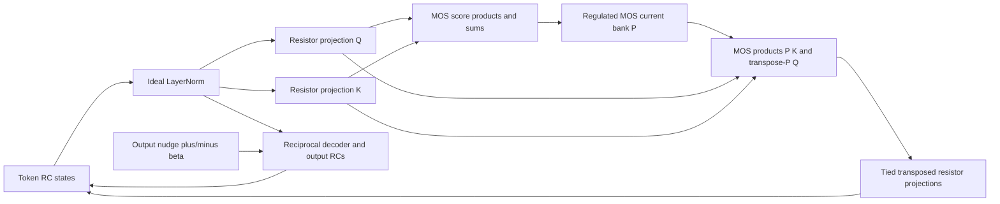

# MOS attention circuit and simple task learning

User assignment, 13 November 2026: implement end-to-end analog attention,
modify return paths if necessary for learning-signal propagation, and train
it on a simple task. This extends issue #36 on the user-named
`energy-transformer` branch. Implementation and bounded local task training
are authorized; GPU/remote or larger dataset studies are outside this pilot.

## Frozen first task and decision

Train a three-token, one-head, width-three custom convergent energy network.
Input `[a,b,0]`; target at the masked third token is `(a+b)/2`. The two supplied
values vary independently. Only the third output is nudged/scored. This task
requires cross-token communication but does not establish selective retrieval.
The circuit has 27 logical parameters, 12 RC states, 198 differential weight
resistors, 27 four-NMOS product cells and nine BSIM3 normalization transistors.
Every score product, query return and key return uses the same native product
cell. There is no independent V projection. Normalization, ReLU, isolation,
current readout, drain regulation and exact resistor programming remain ideal.

Acceptance: final held-out masked MSE is at most 25% of initialization, below
the zero-output baseline, and below the same trained circuit with Q/K weights
zeroed. Require settled phases, operating-domain checks and measured EP versus
finite differences of the actual SPICE equilibrium loss, before and after
training. Use the final epoch, never held-out checkpoint selection. A negative
result remains negative evidence; these criteria do not authorize tuning a
published run to pass.

Initialization: NumPy generator seed 20261113; Q/K shapes (1,1,3), memory (2,3),
encoder (3,1), decoder (1,3), position (3,3), drawn in that order. Position
standard deviation .2, all other groups .08. Epsilon .5, attention scale 1.
Full batch: 12 independent uniform pairs in [-.4,.4], seed 3100. Held out: 32
fresh pairs, seed 3102, not used in development. Centered EP beta .005; digital
Adam controller, LR .003, moments .9/.999, epsilon 1e-8, 200 updates. All six
parameter groups train and all physical copies receive the tied coefficient.
The frozen config is `examples/mos_attention_learning.json`.

All free, minus and plus equilibria, evaluation and ablation are solved by
ngspice. No ideal solver, backpropagation or numerical model gradient supplies
a training update. The software controller computes local products from
measured ports and programs exact resistor values. This is circuit-in-the-loop
EP simulation, not a fabricated on-chip programming controller.

## Circuit and energy

Four matched long-channel LEVEL=1 NMOS transistors form each product. Gates
are 1.5 +/- .05*x V; drains are .3 +/- .05*y V. The signed sum of drain
currents cancels common terms and Vds-squared terms, leaving KP*.1^2*x*y.
A transimpedance readout gives the normalized product voltage. For operands
in [-4,4], minimum Vds is .1 V and the triode margin is at least .3 V.
These are nominal MOS equations, not a foundry device accuracy claim.

The current-normalization bank uses native generic BSIM3 transistors with
body tied to source and **regulated Vds=3 V**. High-impedance source sensing
controls an ideal drain buffer whose return is the supply, not the floating
tail node. Gate voltage is `.7 + .0345*kappa*score`; tail current is 1 nA.
The approximate exponential law is not treated as an exact softmax.

At DC each matched device has current f(v_j-lambda), with f monotone in the
operating domain, common source lambda and sum_j f(v_j-lambda)=I_tail.
Let F'=f and define

    G(v) = min_lambda [I_tail*lambda + sum_j F(v_j-lambda)].

The envelope derivative is dG/dv_j=I_j. Its Hessian is
`diag(f') - f' f'^T / sum(f')`, symmetric positive semidefinite. Therefore
`G(.7+.0345*kappa*scores)/(.0345*kappa*I_tail)` replaces
`logsumexp(kappa*scores)/kappa` in the attention potential. Its derivative
with respect to a score is the measured probability I_j/I_tail. Both
`P K` and `P^T Q` return terms and all six EP phase statistics remain the
energy derivatives, without differentiating the BSIM equations digitally.

The rest of the energy is the existing regularized-LayerNorm Legendre term,
input/position coupling, squared-ReLU memory term and reciprocal output
coupling in `networks/energy_transformer/convergent.py`. The static equilibrium
energy is exact for the declared matched model and ideal regulators. Its
quasistatic state dynamics dissipate that energy. The compact model includes
internal charge dynamics; empirical SPICE settling is checked, not advertised
as a global Lyapunov proof for all parasitic transients or fabricated devices.

## Relation to the papers and remaining circuit stages

[Bacvanski et al., Appendix J, Eq. 97](https://arxiv.org/html/2512.15002v1#A10)
write the Analog ET attention energy using learned affine scores. This
implementation instead computes bilinear scores from two evolving token
projections and explicitly includes both derivatives in its state drive.

[Abbott and Machta](https://arxiv.org/pdf/2610.12571) implement bump-based
similarity and restore learning signals with a doubled/dyadic circuit. Here,
the score is a nominal bilinear MOS product; the reciprocal state drive is
derived from a scalar energy, with the normalized-current potential above.
This pilot does not reproduce their in-context learning result or its task.



The memory/ReLU path, persistent input drive and bias sources also feed the
state nodes; the diagram focuses on the attention/learning loop. The chosen
RCs use simulation-scale time constants (1 ms tokens, 1.3 ms outputs; 100 nF
and 130 nF at 100 uS leak). These are not on-chip area or speed targets.
Foundry models, mismatch/noise, finite amplifier bandwidth, physical weight
writing and compact normalization/rectification remain subsequent stages.
A selective retrieval task is the next scientific test before model scaling.

## Development evidence and changes before freeze

Preserved under `/tmp/mos-attention-learning/`:

- `triode-001`: 9x9 signed operand DC grid, maximum product error 2.49e-14;
  circuit simulation succeeded but terminal-file parsing failed because the
  scalar vector retained the transient scale. `triode-002` fixes the scale and
  matches the reference endpoint to 1.98e-13. The failed output is retained.
- `numerical-learning-001`/`003` and `copy-004`: proposed four-token paired
  copying did not meet the learning target; large weights also slowed settling.
  It is not a successful copying result. The initial task proposal is replaced
  before formal execution by masked averaging, a smaller necessary first test.
- `numerical-learning-mean-001`: four-token averaging reached held-out MSE
  .000845 from .02595 at 200 numerical EP updates; no-attention .02447.
  `numerical-learning-small-001`: three-token version reached .000738 after
  300 numerical updates; no-attention .02410. These are feasibility references,
  not evaluated circuit-trained weights. Development held-out seed was 3101.
- `bsim-001`, `native-001` through `004`, and `native-small-001/002`: native
  bank development. Regulated-bank Jacobian asymmetry below 6e-11. Early
  startup failures were retained; readout conditioning and a constrained DC
  bias solve allow reset-start transients. Importing a settled RC state into
  a fresh native netlist can still trigger initial-timepoint SPICE failure.
  All evaluated phases therefore start from reset; small-nudge branch
  consistency is checked against actual-circuit finite differences.
- `native-readiness-001/20261113T180254.113454Z-d8f432af-608ae0b2`: public CLI
  smoke, 2 updates on 2 samples and 2 development test samples. All six EP
  directional derivatives agree with SPICE finite differences to <2.7e-5
  relative error. It completed 50 valid phases; task accuracy criteria did
  not pass after two updates, as expected for this readiness-only run.
- 16 affected tests passed, including native bank and circuit EP regression
  plus the existing four-token circuit/reference checks.

## Resources, execution and monitoring

Local CPU, one thread. Development allowance 30 minutes computation and 2 GB;
first formal training allowance 30 minutes wall time and 2 GB. Measured small
circuit throughput is .12-.17 s/terminal phase; expect roughly 20 minutes for
7,200 training phases plus diagnostics/evaluation. No GPU/remote use.

Each phase integrates from reset for 300 normalized time units (0.3 s model
time). If terminal KCL residual exceeds 1e-7, repeat that phase from reset for
1,200 then 4,800 units; retain all attempts and never update from an unfinished
phase. Other circuit failures stop the run. Score and return products must
remain within the declared triode domain. Fixed generic model parameters are
not calibrated or retuned during learning.

Save all phase netlists, logs and terminal measured ports losslessly compressed;
retain full transient waveforms for initial/final gradient-diagnostic free
phases. Retain initialization, every 20th update, final parameter/controller
checkpoints, train loss curve and initial/final/ablated test predictions. No
raw evidence is silently discarded. Large artifacts stay outside Git.

Native root: `/home/filip/analog-research/drn/results/mos-attention-learning/`.
Launch from a clean pinned checkout of the merged/pushed source, using:

```sh
PYTHONDONTWRITEBYTECODE=1 OPENBLAS_NUM_THREADS=1 OMP_NUM_THREADS=1 \
/home/filip/miniconda3/bin/python -m ebl train \
  --config examples/mos_attention_learning.json \
  --output-dir /home/filip/analog-research/drn/results/mos-attention-learning/task-001
```

Owner: executing Codex agent, direct supervision. Check process and epoch/log
artifact progress at most 60 seconds apart; each batch should take ~6 seconds.
Record exact launch SHA, pinned checkout, handle and deadline when launched.
Use `python -m ebl runs inspect RUN_DIR --verify-artifacts --require-complete`
for collection. Preserve failed attempts; operational fixes only within the
remaining budget. Do not change scientific settings as an automatic retry.

## Active handoff

Launch source `ff5be7b3491ba16c0fa20e3add09372ec5c9e82b`, clean and pushed to
`energy-transformer` and `refactor/training-core`. Pinned checkout:
`/home/filip/analog-research/drn/results/mos-attention-learning/source-ff5be7b`.
Integrated validation: 41 passed, one unrelated architecture test skipped.

Run started 2026-11-13 18:08:45 UTC; hard deadline 18:38:45 UTC. Tool execution
session 60199, parent PID 1508055. Native bundle:
`/home/filip/analog-research/drn/results/mos-attention-learning/task-001/20261113T180845.863831Z-a26f3db6-e035838e`.
Log: `/home/filip/analog-research/drn/results/mos-attention-learning/task-001.log`.
Initial bank/EP checks passed and epochs 0–2 emitted valid measured metrics.
Owner remains the executing agent; next check within 60 seconds. Task result
is pending, not yet a learning claim.
